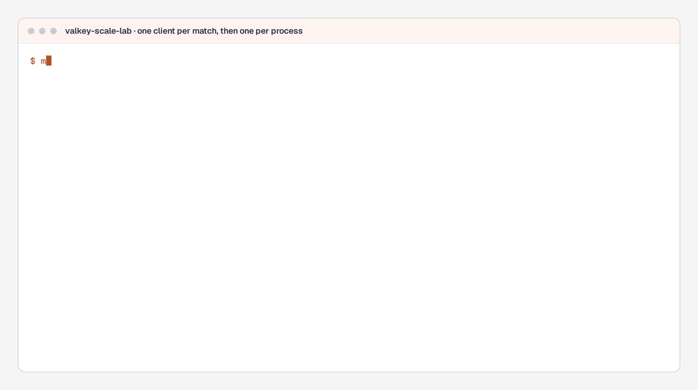

# valkey-scale-lab

[](https://github.com/lasttoss/valkey-scale-lab/actions/workflows/ci.yml)

The same 600 matches: 500 connections, or a single-digit pool.

A Redis (Valkey) client created inside a match handler looks like a local variable. It is a
connection pool, and a pod running ten thousand matches has ten thousand pools - which is how a real
incident reached **10,120 client connections from one pod** and a server that answered
`max number of clients reached`.

This repository reproduces the mechanism against a real server, measures it with the server's own
`INFO`, and keeps the fix under a gate that fails when the numbers stop having the incident's shape.
The measured tables are in **[docs/measurements.md](docs/measurements.md)**, written by `make
measure` rather than by hand.


**Figure 1.** The same work, twice. The left column is a `redis.NewClient` inside the match handler:
the connection count is a function of the match count, and 500 is the server's `maxclients`, so the
column ends with 103 matches that never got a connection. The right column is one client, cached by
`(address, database)`, with an explicit pool. The figure is generated by
[`docs/figures/valkey-scale-lab-flow.generator.py`](docs/figures/valkey-scale-lab-flow.generator.py)
from the numbers in `docs/measurements.md`.

**Where to look first:** [`internal/hotpath/hotpath.go`](internal/hotpath/hotpath.go) holds the two ways a
game server gets a connection, which is the incident itself, and
[`internal/keywalk/keywalk.go`](internal/keywalk/keywalk.go) the two ways to ask for a set of keys.
[`docs/production-notes.md`](docs/production-notes.md) reads the numbers for capacity planning; `make measure`
regenerates them.

## The incident and the fix, running



*Two of the five runs behind `make measure`, against a real Valkey with `--maxclients 500`. The output is the command's; the pauses between lines are the recording's.*

## What this demonstrates

- **A connection incident, reproduced and measured.** `mode=leak` opens one client per live match;
  300 matches reach 303 connections, 600 matches hit the server's ceiling at 500 and 103 matches are
  refused. The client's error for a refused connection is `EOF`, not the sentence in the server log,
  which is why searching for `max number of clients reached` in the application code finds nothing.
- **The fix, and why it is not "raise the limit".** One client per process, keyed by address *and*
  database; `MaxActiveConns` as the ceiling (`PoolSize` is not one - the pool allocates past it under
  load); and `SCAN` instead of `KEYS` for keyspace walks. The same 600 matches then hold 7
  connections and produce zero errors.
- **The keyspace walk as a latency problem.** `KEYS` over 200,600 keys, 20 walks: 571 ms total, 295 ms
  of it inside the server, and the worst round trip an unrelated client saw is **18.7 ms**. `SCAN` over
  the same keys: 1.371 s total, no blocking call, worst round trip **3.8 ms**. SCAN is the slower tool
  and the better one.
- **Measurement from outside the thing being measured.** Every connection number is the server's own
  `INFO` (`connected_clients`, `maxclients`, `total_connections_received`, `cmdstat_keys`). Latency is
  a second client probing `PING` in a loop, reporting p50/p99/p99.9/max, because "the server was
  blocked" is a claim about everybody else.
- **A gate that can fail.** `cmd/lab` exits non-zero when the numbers do not have the incident's shape:
  a client per match that does not show up as a connection per match, a leak past a ceiling with
  nothing refused, or a `SCAN` sweep the server counted as `KEYS`.

## Repository standard

```bash
make test      # vet, unit tests (miniredis for the loop, table tests for the INFO parser)
make mutate    # break the fix on purpose; each mutation has to make the suite red
make measure   # start Valkey, reproduce the incident, regenerate docs/measurements.md
make chart     # lint, render both modes, validate with kubeconform
make diagram   # regenerate the figure and check it against its declared sources
make down      # stop the server
```

`make measure` needs Docker and binds host port **6479**, because a developer machine usually
already has something on 6379 and this lab opens sockets on purpose.

## The numbers

The tables are generated by `make measure`; `docs/measurements.md` has the whole run. The two rows
that matter:

| mode | matches | connections on the server | clients in this process | errors |
|---|---|---|---|---|
| leak | 300 | ~303 (the match count) | 300 | 0 |
| leak | 600 | 500 (the ceiling) | 600 | ~100 |
| fixed | 300 | single digit | 1 | 0 |
| fixed | 600 | single digit | 1 | 0 |

## What this is not

- **Not a leak detector.** The clients are held open on purpose, because a live match held one. The
  real incident reached 10,120 connections over hours; this lab reaches 500 in one run so that the
  wall fits on a laptop.
- **Not a benchmark of Valkey.** The latency numbers are loopback on one machine. The shape of the
  `KEYS`/`SCAN` difference is the finding, not the microseconds.
- **Not the SQL half.** Keyset pagination, an append-only audit table and an idempotent event worker
  live in `liveops-console` and `nakama-migration-kit`, where a database does real work. A second
  container here that no measurement touches would cost every run and teach nothing.

Production notes - the kernel and cgroup limits around this class of incident, and what to panel -
are in **[docs/production-notes.md](docs/production-notes.md)**.
